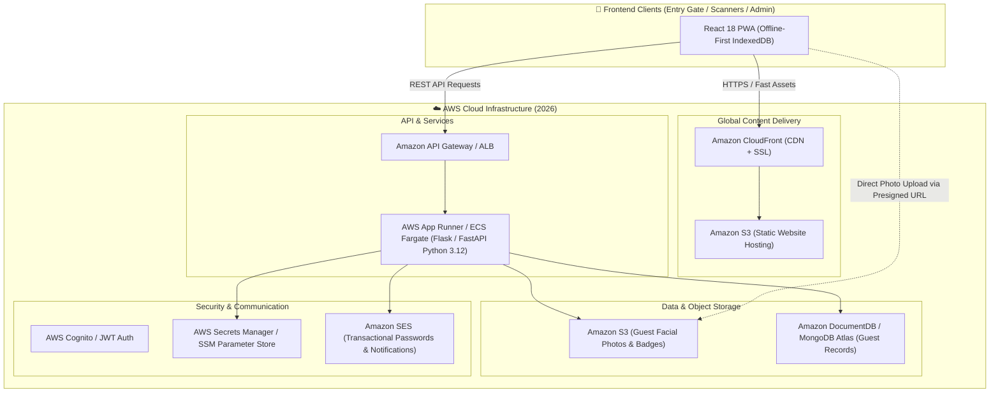

# 🚀 Phase 0: Repository Cleanup & AWS Modernization Roadmap (2026)

> **Divine Energy Hub — Event Management System**  
> **Status:** Planning & Setup  
> **Preceded by:** [Phase -1: Initial Codebase Audit](file:///c:/Users/Admin/Downloads/final_Event_Mangement-app-main/phases%20of%20dev/phase_-1.md)  
> **Next Phase:** Issue Resolution & Implementation

---

## 🎯 Phase 0 Mission & Objectives

Before jumping into individual bug fixes, **Phase 0** establishes a clean, modern, and production-ready foundation for the **2026 Event Management System**. 

The key goals of Phase 0 are:
1. **Repository Hygiene & Sanitization:** Eliminate orphan test files, loose root CSV files, and sensitive committed artifacts (`bfg.jar`, `serviceAccountKey.json`, `.env`).
2. **Standardized Directory Structure:** Separate concerns cleanly into structured directories (`frontend/`, `backend/`, `infra/`, `scripts/`, `phases of dev/`).
3. **AWS Architecture Blueprint:** Transition from disparate third-party services (Vercel, Firebase Storage/Auth, Gmail SMTP) to a unified, scalable **Amazon Web Services (AWS)** infrastructure.
4. **2026 Runtime & Dependency Alignment:** Upgrade runtimes to current 2026 LTS standards (Node.js 20/22 LTS, Python 3.12+), replacing unmaintained packages (e.g., `react-qr-scanner@alpha`).

---

## 🧹 1. Repository Cleanup Checklist

### 1.1 Root Clutter Elimination
The repository root currently contains loose data, utility scripts, and binaries that must be removed or moved to dedicated directories:

| File | Current Location | Phase 0 Action |
|---|---|---|
| `6 oct 7am - new .csv` | Root | Move to `data/archive/` or delete from tracking |
| `today entry.csv` | Root | Move to `data/archive/` or delete from tracking |
| `asthamashibir_dummy_data.csv` | Root | Move to `data/sample/` |
| `bfg.jar` | Root | Remove from repository (store tools outside source control) |
| `serviceAccountKey.json` | Root | Remove from git index, rotate credentials, add to `.gitignore` |
| `.env` | Root | Untrack from git, maintain sanitized `.env.example` |
| `create_uniform_guests_csv.py` | Root | Move to `scripts/data_migration/` |
| `import_guests_data_to_db.py` | Root | Move to `scripts/data_migration/` |

### 1.2 Git Tracking & Security Cleaning
- Purge cached sensitive files from git tracking using:
  ```bash
  git rm --cached serviceAccountKey.json
  git rm --cached .env
  ```
- Update `.gitignore` to strictly exclude:
  ```gitignore
  .env*
  !.env.example
  *.pem
  *.key
  serviceAccountKey.json
  aws-credentials.json
  data/*.csv
  *.jar
  ```

---

## ☁️ 2. Target AWS Architecture for 2026

The 2026 architecture consolidates hosting, computing, data, storage, and authentication onto AWS for enterprise-grade scalability, security, and high availability on event day.



### 2.1 AWS Component Mapping

| Legacy / 2025 Component | AWS 2026 Replacement | Benefits & Rationale |
|---|---|---|
| **Vercel Frontend Hosting** | **Amazon S3 + CloudFront** (or AWS Amplify) | Sub-millisecond static asset delivery, custom domain SSL, no cold starts, cost-effective. |
| **Local / Render Flask Backend** | **AWS App Runner** or **ECS Fargate** | Fully managed containerized service, auto-scaling to handle peak arrival surges at entry gates. |
| **Firebase Storage (Face Photos)** | **Amazon S3 Bucket** | Direct browser upload/download via presigned URLs; private buckets with IAM policy enforcement. |
| **Gmail SMTP (App Passwords in `.env`)** | **Amazon SES (Simple Email Service)** | High deliverability, no account lockouts, secure IAM credentials without plaintext passwords. |
| **Plaintext Firestore Passwords** | **AWS Cognito User Pools** (or Bcrypt + JWT in API) | Built-in password hashing, token validation, refresh tokens, role-based access control. |
| **Committed `.env` & Credentials** | **AWS Secrets Manager** | Encrypted storage for DB connection strings, API tokens, and runtime secrets. |
| **External MongoDB Atlas** | **Amazon DocumentDB** or **MongoDB Atlas on AWS VPC** | Low-latency private VPC connection with TLS encryption and automatic backups. |

---

## 🛠️ 3. 2026 Technology Stack Modernization

### 3.1 Frontend Modernization (React)
- **Node.js LTS:** Standardize on Node.js 20.x or 22.x LTS.
- **Scanner Upgrade:** Replace deprecated `react-qr-scanner@1.0.0-alpha.11` with:
  - `@yudiel/react-qr-scanner` or `html5-qrcode` (proven stability on iOS Safari & Android Chrome).
- **Offline Resiliency:** Retain and optimize IndexedDB local caching (`guestCache.js` + `offlineQueue.js`) to guarantee gate operations continue even if network drops during peak event hours.
- **Strict Error Boundaries:** Implement top-level and route-level error boundaries so individual scanner issues never crash the entire application.

### 3.2 Backend Modernization (Python)
- **Python 3.12+ Standards:** Replace all deprecated `datetime.utcnow()` with timezone-aware `datetime.now(timezone.utc)`.
- **API Security:** Enforce JWT Bearer authentication or API Keys on every endpoint.
- **Production WSGI/ASGI Server:** Use `gunicorn` + `uvicorn` (or containerized Docker image) rather than Flask development server.

---

## 📋 4. Phase 0 Execution Action Log

| Task | Description | Status |
|---|---|---|
| **0.1 Root Clutter Elimination** | Loose CSVs moved to `data/archive/` and `data/samples/`. `create_uniform_guests_csv.py` and `import_guests_data_to_db.py` moved to `scripts/data_migration/`. | ✅ **Completed** |
| **0.2 Git Index Sanitization** | `bfg.jar` removed from git tracking and deleted. `.gitignore` updated to strictly ignore `.env*`, `serviceAccountKey.json`, `*.jar`, and `data/archive/`. | ✅ **Completed** |
| **0.3 2026 Environment Standard** | `.env.example` overhauled with AWS S3, SES, Cognito/JWT, Region, and DocumentDB settings. | ✅ **Completed** |
| **0.4 Backend 2026 Dockerization** | `backend/Dockerfile` updated to Python 3.12-slim with Gunicorn 4-worker production WSGI server. Added `docker-compose.yml` for unified local dev. | ✅ **Completed** |
| **0.5 AWS S3 & SES SDK Setup** | Added `boto3` and `gunicorn` to `backend/requirements.txt`. Implemented `backend/aws_utils.py` with presigned S3 upload/download and SES email helpers. | ✅ **Completed** |
| **0.6 Frontend S3 Integration Helper** | Implemented `src/utils/s3Utils.js` for direct presigned photo uploads from browser to S3. Added `/api/aws/presigned-upload` endpoint in `backend/app.py`. | ✅ **Completed** |

---

## 📌 Deliverables of Phase 0
1. [`phases of dev/phase_-1.md`](file:///c:/Users/Admin/Downloads/final_Event_Mangement-app-main/phases%20of%20dev/phase_-1.md) — Baseline codebase audit report.
2. [`phases of dev/phase_0.md`](file:///c:/Users/Admin/Downloads/final_Event_Mangement-app-main/phases%20of%20dev/phase_0.md) — Completed Phase 0 cleanup and architecture roadmap.
3. [`backend/aws_utils.py`](file:///c:/Users/Admin/Downloads/final_Event_Mangement-app-main/backend/aws_utils.py) & [`src/utils/s3Utils.js`](file:///c:/Users/Admin/Downloads/final_Event_Mangement-app-main/src/utils/s3Utils.js) — AWS integration utilities.
4. [`backend/Dockerfile`](file:///c:/Users/Admin/Downloads/final_Event_Mangement-app-main/backend/Dockerfile) & [`docker-compose.yml`](file:///c:/Users/Admin/Downloads/final_Event_Mangement-app-main/docker-compose.yml) — Production container specifications.
5. Clean repository structure with zero tracked sensitive files or loose binaries.

---

## ⏭️ Ready for Phase 1: Issue Resolution & Security Hardening
With the codebase sanitized and AWS foundations in place, Phase 1 will execute the bug fixes identified in Phase -1:
- Bcrypt password hashing & authentication hardening
- Frontend null-safety & camera leak fixes
- Deprecated QR scanner package migration
- End-to-end integration testing for 2026 readiness
